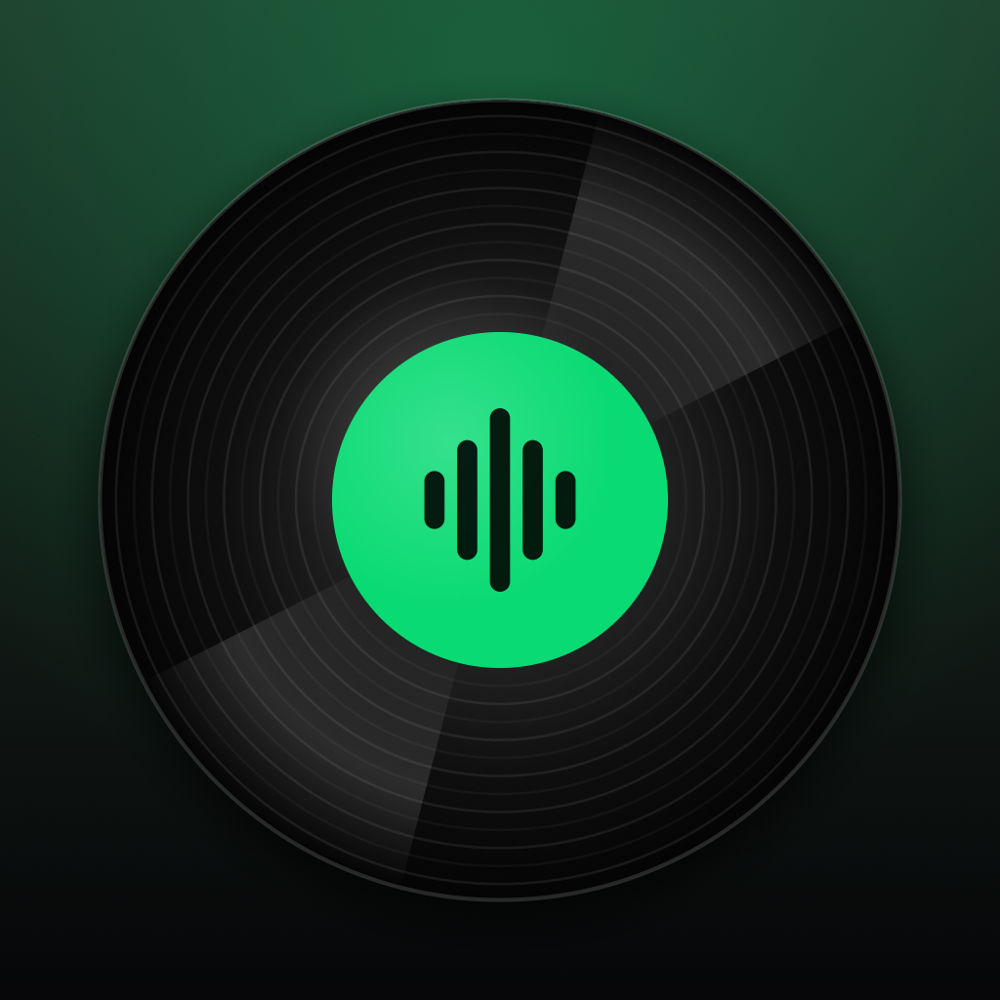

<p align="center">
  
</p>

<h1 align="center">MoodMix</h1>

<p align="center">
  Mood-based, smoothly mixed queues from <b>your own</b> Spotify playlists, as a floating Mac widget and an iPhone app.
</p>

<p align="center">
  <a href="https://github.com/saxenapratham6/MoodMix/releases/latest"></a>
  <a href="LICENSE"></a>
  
  
  
</p>

Pick a mood and MoodMix builds a queue **only from your playlist** (no songs Spotify slips in), leaning on the songs you play most. It orders them so each one flows into the next (matching keys and tempos, shaping the energy) and plays them on your Spotify. It learns from your skips, and on the iPhone you can swipe through new songs similar to yours.

> Requires **Spotify Premium** (Spotify only lets Premium accounts be controlled by other apps). An **Anthropic API key** is recommended for labeling each song's mood.

## Contents

- [Installation](#installation)
  - [macOS](#macos)
  - [iPhone](#iphone)
  - [Build from source](#build-from-source)
- [First-time setup](#first-time-setup)
- [Features](#features)
- [How it works](#how-it-works)
- [Security](#security)
- [Contributing](#contributing)
- [License](#license)

## Installation

### macOS

1. **Download** `MoodMix-macOS.zip` from the [latest release](https://github.com/saxenapratham6/MoodMix/releases/latest).
2. **Unzip** it (double-click the file) to get `MoodMix.app`.
3. **Drag `MoodMix.app` into your Applications folder.**
4. **Open it.** MoodMix isn't notarized by Apple, so the first time macOS says it can't verify the app:
   - right-click `MoodMix.app` → **Open** → **Open**, or
   - open **System Settings → Privacy & Security**, scroll down and click **Open Anyway**.
5. MoodMix appears as a glass bar at the bottom of your screen and a 〰 icon in the menu bar. It has no Dock icon.

**Start at login:** System Settings → General → Login Items → **+** → MoodMix.

**Updating:** download the new zip and replace `MoodMix.app` in Applications. Your settings and labels stay.

**Uninstalling:** quit from the 〰 menu, delete `MoodMix.app`, and optionally remove `~/Library/Application Support/MoodMix` and the *MoodMix* entries in Keychain Access.

### iPhone

The iPhone app is installed from Xcode onto your own phone (it isn't on the App Store).

1. Install [Xcode](https://apps.apple.com/app/xcode/id497799835) 26 or later, and add your Apple ID in **Xcode → Settings → Accounts** (a free Apple ID works).
2. Clone this repository and open `iOS/MoodMixiOS.xcodeproj`.
3. For both the **MoodMixiOS** and **MoodMixWidgets** targets, open **Signing & Capabilities** and choose your Team. If Xcode says the bundle ID is taken, change `com.saxenapratham.moodmix` to something unique (the widget's ID must start with the app's).
4. Connect your iPhone, select it at the top of Xcode, and press **Run**.
5. On the iPhone:
   - turn on **Settings → Privacy & Security → Developer Mode** (it restarts the phone), and
   - trust yourself in **Settings → General → VPN & Device Management**.

With a free Apple ID, the app stops opening after 7 days. Plug in and press **Run** again; your login, labels and stats are kept. A paid Apple Developer account removes the limit.

### Build from source

macOS 14+ and Xcode 26 (or its command line tools):

```bash
git clone https://github.com/saxenapratham6/MoodMix.git
cd MoodMix
./scripts/run-mac.sh       # build, sign with your Apple Development certificate if you have one, and start
./scripts/package-mac.sh   # build dist/MoodMix.app and dist/MoodMix-macOS.zip
swift test                 # run the tests
```

The iPhone project is generated from `iOS/project.yml` with [XcodeGen](https://github.com/yonaskolb/XcodeGen) (`cd iOS && xcodegen generate`).

## First-time setup

MoodMix talks to Spotify through **your own** Spotify developer app, so nothing goes through anyone else's servers.

1. Go to the [Spotify Developer Dashboard](https://developer.spotify.com/dashboard) and click **Create app**:
   - **Redirect URIs:** add `http://127.0.0.1:8888/callback` (Mac) and `moodmix://callback` (iPhone). Click **Add** for each, then **Save**.
   - **APIs:** tick **Web API**.
   - In **User Management**, add the Spotify accounts that may use it (yours is added automatically).
2. Copy the app's **Client ID**. It's labeled *Client ID*; you never need the *Client secret*.
3. Optional but recommended: create an API key at the [Anthropic Console](https://console.anthropic.com).
4. In MoodMix, open **Settings** (〰 menu → Settings on the Mac; the gear on the iPhone), paste the Client ID and the Anthropic key, and log in with Spotify.
5. Pick your playlist. MoodMix measures each song, labels its moods once, and saves the result.

Already labeled everything on the Mac? Use **Settings → Export labels for iPhone**, AirDrop the file to your phone, and the iPhone won't label those songs again.

## Features

**Mac widget**
- A Liquid Glass bar tinted with the current album art: now playing, ⏮ ⏯ ⏭, **Generate**, and a card that slides out with playlists, moods, energy shape, length and how much your favorites count.
- **Queue:** drag to reorder, remove, double-click to jump, or search your playlist to add a song next or at the end. Add a happy song to a sad queue and the sad songs carry on after it; the queue tops itself up in its mood.
- **Bubble:** drag the bar to a screen edge and it becomes a spinning vinyl record with the cover as its label; hover for ⏮ ⏯ ⏭.
- **Menu bar panel** in the style of macOS's Now Playing, with quick moods.
- **Shortcuts from any app:** ⌃⌥G generate · ⌃⌥Space play/pause · ⌃⌥← → previous/next · ⌃⌥O card · ⌃⌥M widget · ⌃⌥B bubble · ⌃⌥1–8 mood mixes.
- **Sleep timer:** after this song, at the end of the mix, or fade out after 15–90 minutes.

**iPhone app**
- **Now:** a spinning vinyl of the current song, moods, Generate and Match.
- **Discover:** swipe through songs similar to your favorites, your queue, a mood, or any song you search for. Right adds to a playlist or the queue, up plays next, left skips; tap to listen.
- **Profile:** songs explored, added and skipped, keep rate, day streak, the moods you discover, and recent finds.
- **Widgets:** a Home Screen mood grid and Lock Screen buttons that start a mix.
- **Labels are never paid for twice:** kept in the iPhone's Keychain (which survives reinstalling), and batches of more than 25 songs ask first.

**Both**
- **Auto mood** from the time of day, your headphones and your habits; **journeys** through up to 4 moods (e.g. Sad → Chill → Happy).
- **Learns from you:** skipping a song lowers its fit for that mood, listening through raises it; you can also set a song's mood yourself.
- **Save the queue as a playlist**, see your playlist by mood, remove duplicate songs, and **export** playlists as CSV for TuneMyMusic/Soundiiz (to move to Apple Music or YouTube Music) or JSON.

## How it works

1. **Load** your playlist with the official Spotify Web API, and score favorites from your top tracks and Liked Songs.
2. **Analyze** each song once: energy, mood, tempo and key from [ReccoBeats](https://reccobeats.com) (Spotify closed its audio-features API to new apps in 2024), and mood labels from Claude. Everything is saved.
3. **Pick** the songs that fit the mood, weighted by how much you love them, with a little randomness so every mix differs.
4. **Order** them so neighbors share a compatible key on the Camelot wheel and a similar tempo (half and double time count), following your energy shape, never repeating an artist back to back.
5. **Play** them from a private *MoodMix Queue* playlist in your library (Spotify's desktop app can silently drop plain lists of songs), check the first song really started, and keep following Spotify as you skip.

Crossfading is done by Spotify itself: turn on **Settings → Playback → Crossfade** or **Automix** in Spotify. MoodMix's ordering makes those blends land well.

## Security

- **No secrets in this repository.** Spotify login uses PKCE, so there is no client secret; the Client ID you paste and your tokens stay on your device.
- **Mac:** your Spotify login and Anthropic key live in your login Keychain, readable only by MoodMix. Any other program, even `security`, makes macOS ask you.
- **iPhone:** secrets are readable only while the phone is unlocked and never leave it (not in backups, not moved to a new phone).
- **Spotify login on the Mac** listens on `127.0.0.1` only, for at most 5 minutes, and rejects forged callbacks.
- **Spotify Development Mode** only lets the accounts in your app's *User Management* log in.
- Keys are only sent, over HTTPS, to `api.anthropic.com`, `api.spotify.com` and `accounts.spotify.com`; logs never contain them.

Found a security problem? Please open an issue without the details, and I'll get in touch.

## Contributing

Issues and pull requests are welcome.

- `Sources/MoodMixCore`: shared logic (Spotify, mixing, queue, learning, discovery), used by both apps.
- `Sources/MoodMixMac`: the Mac widget.
- `iOS/`: the iPhone app and widgets.
- `Tests/`: run with `swift test`.

## License

Licensed under the [MIT License](LICENSE). Copyright © 2026 Pratham Saxena.

MoodMix is not affiliated with, endorsed or sponsored by Spotify. Spotify is a trademark of Spotify AB.
